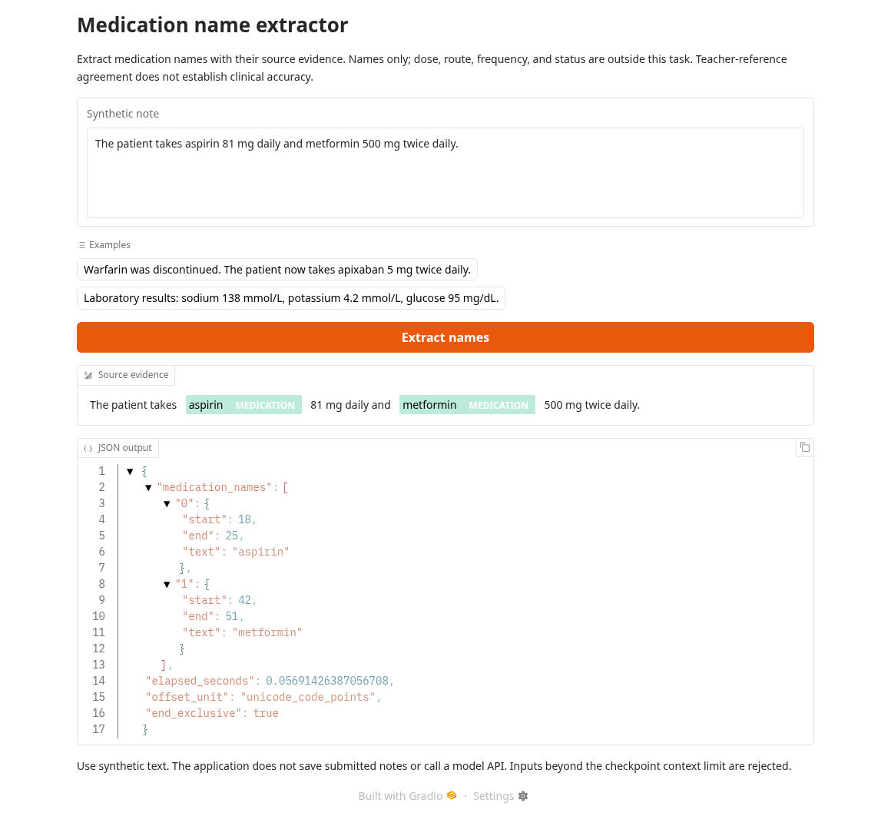
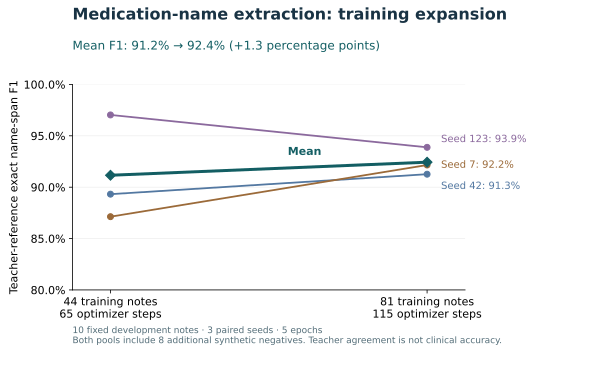

# Clinical Medication Extraction

Train medication-name extractors from LLM-generated, source-checked labels.
Compare a biomedical token classifier with prompted and LoRA-tuned language
models using frozen data splits and controlled experiments.

## Demo

[Try the hosted demo](https://huggingface.co/spaces/emtay152/clinical-llm-extraction)
(Hugging Face sign-in required while the Space is private).

Enter a synthetic note to highlight medication names and inspect their exact
source text, zero-based start positions, and exclusive end positions. Dose,
route, frequency, and medication status are outside this task.



## Performance



The same ten frozen, AI-reviewed development notes were used across three paired
seeds. Mean exact name-span F1 rose from **91.2% to 92.4%**; two seeds improved and
one regressed. This measures teacher-reference agreement, not clinical accuracy
or held-out test performance. Both pools include eight additional synthetic
negatives. Five epochs produced 65 versus 115 optimizer steps, so the comparison
changes training data and compute together.

The demo uses the expanded-pool seed-42 checkpoint (**91.3%** on these references);
92.4% is the three-seed mean. Detailed reports and predictions stay outside Git.
Regenerate the aggregate chart with `python scripts/plot_performance.py`
(requires `matplotlib==3.10.1`).

## Quick start

Python 3.11+; training runs on CPU. From the repository root:

```bash
python -m venv .venv
.venv/bin/python -m pip install torch==2.6.0 --index-url https://download.pytorch.org/whl/cpu
.venv/bin/python -m pip install -r requirements-training.lock
```

Add `TEACHER_API_KEY` securely to your environment for hosted labeling. Follow
[the experiment workflow](docs/experiment.md) to prepare frozen splits, label
medication names, train the token classifier, and evaluate teacher-reference
agreement. Model revisions and training settings are pinned in
`configs/token-classifier.json`.

Use [iterative experiments](docs/iterative-training.md) for overfit checks,
learning curves, ablations, and seed repeats. The [generative workflow](docs/distillation.md)
provides optional prompted and fine-tuned language-model comparisons.

## Try a trained model

Use a saved token-classifier checkpoint from the experiment workflow:

```bash
printf 'The patient takes aspirin daily.' | \
  .venv/bin/python scripts/predict_medication_names.py artifacts/my-classifier
.venv/bin/python scripts/serve_demo.py artifacts/my-classifier
```

The [local demo](docs/token-classifier.md#inference-and-local-demo) opens at
`http://127.0.0.1:8000` with editable synthetic notes and highlighted medication
names. Inference runs locally and returns exact source text and character offsets.
Weights are not distributed with this repository. For remote access, see
[Hugging Face Spaces deployment](docs/deployment.md).

Network access is needed to `huggingface.co`, `*.huggingface.co`, `*.hf.co`,
`api.github.com`, `raw.githubusercontent.com`, and your teacher provider.
Data, credentials, labels, predictions, reports, and weights stay outside Git.
Review upstream data terms before redistribution.

## Tests

Unit tests need only Python and make no network or model API calls:

```bash
python -m unittest discover -s tests -v
```

## Documentation

- [Distillation workflow](docs/distillation.md) and [experiment design](docs/experiment.md)
- [Medication schema](schemas/medications.schema.json) and [annotation protocol](docs/annotation.md)
- [Optional offline annotation tool](docs/annotation-tool.md)
- [Iterative classifier experiments](docs/iterative-training.md) and [training expansion](docs/training-expansion.md)
- [Medication-name token classifier](docs/token-classifier.md) and [name-labeling rules](docs/name-labeling.md)
- [Treatment-name training](docs/training.md)
